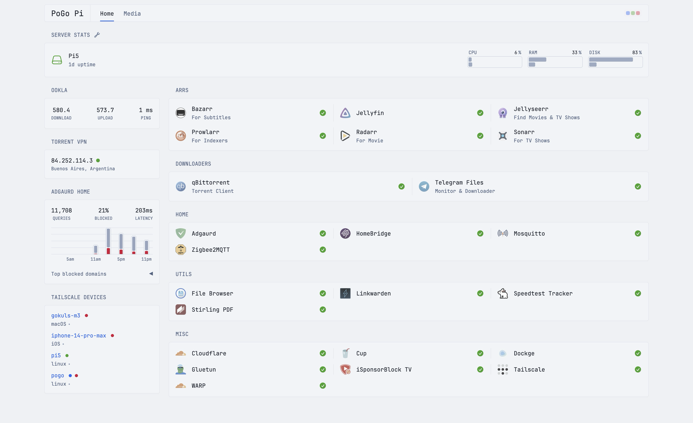
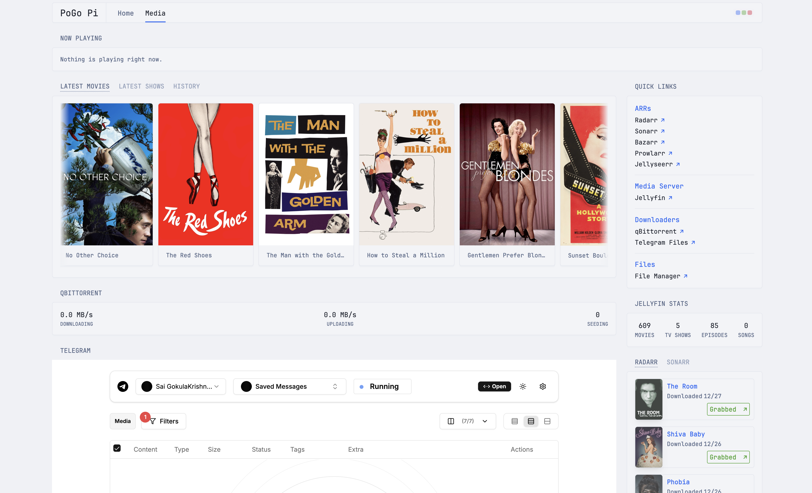

# Glance

Config yml of Glance Dashboard

Media poster templates require `ghcr.io/imgkl/glance:v2026.11.2` or newer. Deploy the published image before updating these templates.

> Remove/comment the `page` from top of file when using this.
> Place the css file in the assets folder

## Home

## Media

